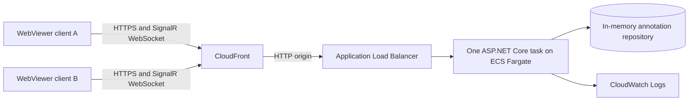
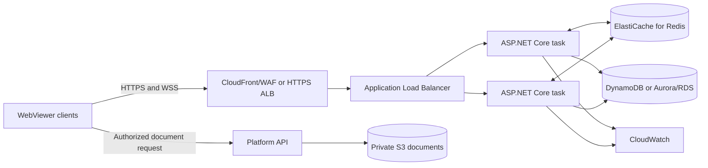

# Apryse WebViewer synchronization on AWS and .NET

This proof of concept shows how to host Apryse WebViewer annotation and comment synchronization entirely inside an AWS environment. It replaces the Firebase role in Apryse's examples with an ASP.NET Core SignalR service that can run as a container on Amazon ECS.

The documents, identities, annotation data, and synchronization traffic can remain in the customer's AWS account. Firebase and Google Cloud are not required.

> This flow synchronizes annotations, comments, replies, and markup represented as XFDF. It does not provide simultaneous editing of DOCX body content.

## Customer answer at a glance

| Customer question | Answer |
| --- | --- |
| Is Firebase or Google Cloud required? | No. Firebase is one example backend. WebViewer exposes client APIs that can be connected to any backend capable of storing and distributing annotation changes. |
| Can synchronization run in the customer's AWS account? | Yes. This repository runs an ASP.NET Core SignalR service in ECS Fargate and was validated through ALB and CloudFront in AWS. |
| Can documents remain in the customer's environment? | Yes. Production documents can remain in private S3 and be delivered through an authorized customer endpoint or short-lived presigned URL. No Firebase service is involved. |
| Is there a .NET synchronization example? | Yes. This directory contains the browser adapter, ASP.NET Core SignalR hub, repository abstraction, container definition, and AWS CloudFormation reference used for the validated POC. |
| Does Apryse provide the synchronization server? | No. Apryse provides WebViewer, annotation events, and XFDF import/export APIs. The customer owns the backend transport, persistence, identity, authorization, AWS infrastructure, and operations. |
| Is this production-ready? | No. It proves the integration and AWS deployment path. Production requires durable storage, authenticated identity, authorization, a Redis backplane for multiple tasks, private networking, monitoring, and the hardening listed below. |

### Data residency and trust boundary

The production design can keep the system of record entirely in the customer's AWS account:

1. Original PDF/DOCX files remain in private S3.
2. The customer platform authorizes a user and provides WebViewer with an authorized document URL. The document necessarily reaches the authorized user's browser for rendering, but it is not sent to Firebase or a Google service.
3. WebViewer emits annotation changes as XFDF. XFDF contains the annotation layer and document/annotation identifiers, not a second copy of the document binary.
4. The browser sends XFDF over WSS to the customer-owned .NET service.
5. The service validates access, stores annotation state in the customer-owned database, and broadcasts changes to other authorized viewers.
6. Logs, encryption keys, backups, alarms, and retention controls remain customer-managed AWS resources.

For strict egress requirements, serve WebViewer assets from the customer's own origin, use VPC endpoints for AWS services, restrict task egress, and verify that application telemetry and licensing configuration meet the customer's policy.

### Public repository safety and licensing

This repository includes only original POC source code, dependency manifests, infrastructure as code, and documentation. It intentionally excludes:

- Apryse WebViewer SDK binaries; `npm install` retrieves the declared official package.
- PDF/DOCX or other customer documents; `sample-files/*` is ignored except for its README.
- AWS account IDs, deployed endpoint names, SSO profiles, access keys, session tokens, and CloudFormation outputs.
- Build output, dependencies, IDE state, local configuration, private keys, certificates, and environment files.

The repository is publicly visible but contains no repository-level software license. Public visibility does not itself grant reuse or redistribution rights. The WebViewer package and any use of Apryse APIs remain subject to the recipient's applicable Apryse license and terms. Confirm licensing with Apryse before production use or redistribution.

## What the POC proves

- WebViewer clients can join a channel identified by the platform's own `documentId`.
- WebViewer can export local annotation changes as XFDF commands.
- An ASP.NET Core SignalR hub can persist and broadcast add, modify, and delete operations.
- Other WebViewer clients can import the XFDF command without creating an event loop.
- The repository includes container packaging and ECS/ALB/CloudFront deployment artifacts for the same service.

The flow has been tested locally with two browser sessions: a note created by one author was persisted by the .NET service and appeared in the second viewer in real time.

The local .NET build, publish, and Linux Docker image are verified. The image was built and run locally; its health endpoint, app shell, WebViewer bundle, annotation API, and cross-origin isolation headers passed smoke tests. The CloudFormation template also passes `cfn-lint`.

On October 22, 2026, the POC was deployed to `ap-southeast-2` and validated through its CloudFront HTTPS endpoint. The final chiseled image had an ECR scan result of zero findings, CloudFormation reached `UPDATE_COMPLETE`, ECS stabilized at one running task, the ALB target was healthy, and CloudWatch showed a clean application startup. Two WebViewer clients connected through SignalR; a note created in one client was stored as revision 1 and appeared as `Comments (1)` in the other. A forced ECS replacement produced a new healthy task, both clients reconnected, and the server snapshot reset as expected for the in-memory repository. Modify and delete operations remain manual validation items.

## POC architecture



The supplied CloudFormation template deliberately runs one ECS task because its repository is in memory. Data is lost when that task restarts. This is appropriate only for demonstrating the protocol and deployment shape.

## Recommended production architecture



Recommended AWS components:

| Concern | AWS/.NET choice | Purpose |
| --- | --- | --- |
| Container runtime | ECS Fargate | Runs the ASP.NET Core synchronization service without managing hosts. |
| Real-time ingress | Application Load Balancer | Supports native WebSocket upgrades and routes `/hubs/collaboration` to ECS. |
| Durable annotation state | DynamoDB or Aurora/RDS | Stores XFDF and ownership metadata by document and annotation ID. |
| Multi-task fan-out | ElastiCache for Redis | SignalR backplane so an event received by one task reaches clients connected to other tasks. |
| Document storage | Private S3 bucket | Keeps PDF/DOCX binaries separate from synchronization state. Use the platform API or short-lived presigned URLs. |
| Authentication | Existing OIDC provider or Amazon Cognito | Issues tokens consumed by ASP.NET Core authentication and authorization. |
| Secrets | AWS Secrets Manager or Parameter Store | Holds database and Redis connection settings. |
| TLS | CloudFront or an ACM certificate on an HTTPS ALB listener | Provides HTTPS/WSS. The POC uses the default CloudFront certificate. |
| Operations | CloudWatch Logs, metrics, and alarms | Tracks failures, latency, task health, and connection load. |

ALB session stickiness is not a replacement for the Redis backplane. A client maintains one WebSocket connection to one task, but annotation events must still cross task boundaries.

### Replacing Firebase responsibilities

| Firebase example responsibility | AWS/.NET replacement |
| --- | --- |
| Firebase Authentication | Existing OIDC identity provider or Amazon Cognito, validated by ASP.NET Core JWT bearer authentication. |
| Firebase Realtime Database | DynamoDB or Aurora/RDS repository containing per-document XFDF state. |
| Firebase child-change listeners | SignalR hub events over WebSockets. |
| Firebase real-time fan-out | SignalR document groups plus an ElastiCache Redis backplane when multiple ECS tasks run. |
| Firebase Database Rules | Server-side ASP.NET Core authorization using tenant, document, author, and role claims. |
| Firebase hosting/operations | Private ECR, ECS Fargate, CloudFront/WAF or an HTTPS ALB, CloudWatch, and the customer's VPC controls. |

### Separate-layer saving versus synchronization

Saving annotations as a separate layer and synchronizing them use the same underlying XFDF data, but solve different problems:

- **Separate-layer saving** exports annotation state to a backend and imports it when a document is opened later.
- **Real-time synchronization** adds operation-level add/modify/delete messages, connected-user channels, immediate fan-out, ordering, reconnect catch-up, and concurrency handling.

The repository interface in this POC covers the separate-layer persistence boundary. The SignalR hub and browser adapter provide the additional synchronization behavior.

## Synchronization flow

1. The platform loads a document into WebViewer and supplies its own stable `documentId`.
2. The browser opens a SignalR connection and calls `JoinDocument(documentId)`.
3. A production service authorizes access, adds that connection to a SignalR document group, and returns the current XFDF snapshot. The POC performs the group and snapshot steps but not authorization.
4. WebViewer raises `annotationChanged` for a local add, modify, or delete.
5. The browser calls `exportAnnotationCommand()`, splits the command by annotation, and sends this payload:

```json
{
	"documentId": "platform-document-123",
	"annotationId": "annotation-guid",
	"operation": "add",
	"xfdf": "<xfdf>...</xfdf>",
	"authorId": "ignored-client-value",
	"revision": 0
}
```

6. The server derives `authorId` from the authenticated principal, validates document access, stores the change, and assigns a revision.
7. The server sends `AnnotationChanged` to the other connections in that document group.
8. Receiving clients call `importAnnotationCommand()` and ignore the resulting `annotationChanged` event when `info.imported` is true. This prevents echo loops.

The POC passes `authorId` in the connection query string for demonstration only. Production code must obtain identity from a validated access token and enforce authorization in both `JoinDocument` and `PublishAnnotation`.

## .NET reference implementation

The relevant example code is intentionally small:

- [`Program.cs`](Program.cs) registers SignalR, serves WebViewer assets with the required MIME/encoding headers, exposes `/health`, returns initial annotation state, and maps the hub.
- [`Hubs/CollaborationHub.cs`](Hubs/CollaborationHub.cs) implements document groups, validation, persistence, revision assignment, and fan-out.
- [`Models/AnnotationChange.cs`](Models/AnnotationChange.cs) defines the client/server synchronization contract.
- [`Services/IAnnotationRepository.cs`](Services/IAnnotationRepository.cs) is the persistence boundary to implement for DynamoDB or Aurora.
- [`Services/InMemoryAnnotationRepository.cs`](Services/InMemoryAnnotationRepository.cs) is the disposable POC repository.
- [`wwwroot/app.js`](wwwroot/app.js) connects WebViewer annotation events to SignalR and applies remote XFDF commands.
- [`Dockerfile`](Dockerfile) builds the .NET service and packages the licensed WebViewer assets.
- [`infra/cloudformation.yaml`](infra/cloudformation.yaml) creates the single-task ECS/ALB POC infrastructure and CloudFront HTTPS endpoint.

### Hub contract

| Name | Direction | Behavior |
| --- | --- | --- |
| `JoinDocument(documentId)` | Client to server | Joins `document:{documentId}` and returns current annotation state. |
| `PublishAnnotation(change)` | Client to server | Validates, persists, versions, and broadcasts one XFDF command. |
| `AnnotationChanged(change)` | Server to client | Delivers a persisted remote change to other viewers of the document. |

For production, consider adding an idempotency/event ID, optimistic concurrency token, server timestamp, tenant ID, and tombstone or event-log strategy for deletes.

## Step-by-step production implementation guide

The following sequence takes the validated POC to a customer-owned production service. Each step has a concrete completion condition.

### 1. Define identity and document keys

- Use the platform's immutable document ID, not a filename or temporary S3 URL, as `documentId`.
- Define tenant ID, user ID, roles, annotation ownership, and document permissions.
- Decide whether annotations are shared by document, document version, workspace, or tenant.

Complete when every synchronization request can be mapped to one tenant, user, document, and document version without trusting values supplied by the browser.

### 2. Keep document delivery separate from synchronization

- Store source documents in private S3 with block-public-access enabled and encryption at rest.
- Authorize each document request through the platform API or issue a short-lived presigned URL.
- Pass the stable platform `documentId` separately to the collaboration client.
- Do not send document binaries through the SignalR hub.

Complete when a user can load only an authorized document and revoking platform access also prevents subsequent document retrieval.

### 3. Integrate the WebViewer client

- Listen for `annotationChanged` and ignore changes where `info.imported` is true.
- Export local changes with `exportAnnotationCommand()`.
- Send add, modify, and delete operations with stable annotation IDs.
- Apply remote changes with `importAnnotationCommand()`.
- Join the document channel only after authentication and WebViewer document load complete.

The reference adapter is [`wwwroot/app.js`](wwwroot/app.js). Complete when two browsers can add, modify, and delete an annotation without event echo loops.

### 4. Define the .NET service contract

- Keep `JoinDocument(documentId)` for authorization, group membership, and initial state.
- Keep `PublishAnnotation(change)` for validation, persistence, revision assignment, and fan-out.
- Keep `AnnotationChanged(change)` as the server-to-client event.
- Add tenant ID from authenticated claims, an idempotency key, a server timestamp, and the chosen concurrency token.
- Set message-size and rate limits based on measured XFDF payloads.

Use [`Hubs/CollaborationHub.cs`](Hubs/CollaborationHub.cs) and [`Models/AnnotationChange.cs`](Models/AnnotationChange.cs) as the starting point. Complete when malformed, unauthorized, oversized, duplicate, and stale operations are rejected deterministically.

### 5. Add authentication and authorization

- Configure ASP.NET Core JWT bearer authentication against the customer's OIDC provider or Cognito.
- Supply the access token to SignalR using `accessTokenFactory`; do not put tokens or author identity in query parameters.
- Derive tenant and user identity only from validated claims.
- Authorize document access before returning a snapshot or joining a SignalR group.
- Enforce create, modify, and delete permissions server-side; WebViewer UI permissions are not a security boundary.

Complete when unauthenticated, cross-tenant, revoked, and unauthorized-owner tests all fail closed.

### 6. Replace in-memory state with durable storage

- Implement [`Services/IAnnotationRepository.cs`](Services/IAnnotationRepository.cs) with DynamoDB or Aurora/RDS.
- Store tenant ID, document ID/version, annotation ID, XFDF, operation/state, author, revision, timestamps, and idempotency key.
- Use conditional writes or transactions for the selected concurrency policy.
- Retain tombstones or an event log when reconnecting clients must learn about deletes.
- Define backup, retention, deletion, legal-hold, RPO, and RTO requirements.

Complete when annotations survive task replacement, deployment, and availability-zone failure, and restore procedures have been tested.

### 7. Support multiple ECS tasks

- Add the ASP.NET Core SignalR Redis backplane using ElastiCache.
- Keep SignalR document groups; Redis distributes group events across tasks.
- Do not rely on ALB stickiness as a backplane.
- Test reconnect and catch-up when tasks scale, drain, or fail.

Complete when clients connected to different ECS tasks receive the same ordered changes and no change is lost during scaling.

### 8. Build and scan the container

- Build from the supplied [`Dockerfile`](Dockerfile), which packages the .NET service and customer-licensed WebViewer assets.
- Use a supported .NET LTS runtime and a minimal/chiseled base image.
- Push only to private ECR, enable scanning, pin an immutable tag or digest, and enforce the customer's vulnerability policy.
- Confirm Apryse asset redistribution terms under the customer's license.

Complete when CI produces a reproducible image, software inventory, acceptable scan report, and signed deployment artifact.

### 9. Deploy the AWS infrastructure

- Start from [`infra/cloudformation.yaml`](infra/cloudformation.yaml).
- For production, run ECS tasks in private subnets across multiple availability zones.
- Use CloudFront/WAF or an HTTPS ALB with ACM; encrypt the origin path and prevent direct origin access.
- Add DynamoDB/Aurora, ElastiCache, KMS keys, Secrets Manager, VPC endpoints, autoscaling, alarms, and AWS WAF controls.
- Apply least-privilege task, execution, deployment, and operator IAM roles.

Complete when infrastructure is reproducible through reviewed IaC and passes the customer's network, IAM, encryption, and resilience controls.

### 10. Add observability and operational controls

- Record connection, authorization, validation, persistence, latency, reconnect, and throttling metrics without logging XFDF content.
- Alarm on unhealthy targets, task churn, hub exceptions, database/Redis failures, elevated reconnect rates, and latency.
- Add correlation IDs across browser, SignalR operation, repository write, and audit event.
- Define runbooks for rollback, task draining, data restore, certificate renewal, secret rotation, and incident response.

Complete when alerts reach the owning team and each critical runbook has been exercised in a non-production environment.

### 11. Run production acceptance tests

- Verify add, modify, delete, comments, replies, permissions, reconnect, catch-up, and simultaneous edits.
- Force task replacement, scale across tasks, interrupt Redis/database connectivity, and test availability-zone failure.
- Load-test expected concurrent WebSocket connections and annotation rates.
- Confirm documents and annotation records remain in approved regions and no unapproved external endpoint receives them.
- Capture CloudFormation/IaC status, image digest and scan, target health, browser evidence, logs, recovery evidence, and security-test results.

Complete only when the solution architect, security owner, platform owner, and operations owner approve the collected evidence.

## Solution architect decision checklist

Before production work begins, obtain explicit answers to these questions:

| Decision | Required answer |
| --- | --- |
| Identity | Which OIDC issuer, token audience, claims, session lifetime, and revocation mechanism will be used? |
| Authorization | Who may view, add, modify, delete, export, and download for each tenant/document? |
| Document versioning | Do annotations follow one immutable version or migrate when the document changes? |
| Persistence | DynamoDB or Aurora/RDS, and what are the key/index, transaction, retention, backup, RPO, and RTO requirements? |
| Concurrency | Last-write-wins, optimistic concurrency, or another merge policy? How are conflicts shown to users? |
| Reconnect | Snapshot plus revision, replayable event log, or another catch-up mechanism? |
| Scale | Expected concurrent viewers, documents, connection duration, operation rate, and XFDF size? |
| Residency | Approved AWS accounts, regions, backup regions, browser populations, and outbound endpoints? |
| Network | CloudFront/WAF or direct HTTPS ALB, private subnet design, origin restriction, VPC endpoints, and egress controls? |
| Security | KMS ownership, WAF/rate limits, audit requirements, vulnerability thresholds, and penetration-test scope? |
| Operations | Owning team, SLOs, alarms, on-call path, deployment strategy, rollback, disaster recovery, and cost budget? |
| Licensing | Which Apryse license covers the users, deployment, and distribution of WebViewer assets? |

## Run locally

Prerequisites are .NET 9 and Node.js. This repository intentionally contains no WebViewer SDK binaries and no document. `npm install` obtains WebViewer 11.13.0 from the official npm package; place a non-sensitive PDF at `sample-files/document.pdf` before starting the application.

From the repository root:

```powershell
npm install
dotnet run --urls http://localhost:5080
```

Open `http://localhost:5080/?documentId=poc-demo` in two separate browser sessions. Add an annotation or note in either viewer and confirm it appears in the other. To use an authorized document endpoint instead of the local file, add `&documentUrl=<URL-encoded-document-URL>`.

Useful endpoints:

- `GET /health`
- `GET /api/documents/{documentId}/annotations`
- `/hubs/collaboration`

## Build the container

Build from the repository root. The build obtains WebViewer from the official npm dependency and includes the ignored local `sample-files` directory. Do not add SDK binaries or documents to Git.

```powershell
docker build `
	-f Dockerfile `
	-t apryse-collaboration-poc .

docker run --rm -p 8080:8080 apryse-collaboration-poc
```

Then open `http://localhost:8080/?documentId=poc-demo`.

Do not publish an image containing Apryse SDK assets to a public registry. Use a private ECR repository and confirm distribution terms under the applicable Apryse license.

## Deploy the POC to ECS

1. Create a private ECR repository.
2. Authenticate Docker to ECR, tag the image, and push it.
3. Select an existing VPC and at least two public subnets in different Availability Zones.
4. Deploy [`infra/cloudformation.yaml`](infra/cloudformation.yaml) with:
	 - `ContainerImage`: complete ECR image URI and tag.
	 - `VpcId`: target VPC.
	 - `PublicSubnetIds`: two or more subnet IDs.
5. Open the `PocUrl` CloudFormation output in two browser sessions.
6. Delete the stack when the demonstration is complete.

The template creates:

- ECS cluster and one Fargate task.
- Internet-facing Application Load Balancer with WebSocket-compatible routing.
- CloudFront distribution with an AWS-managed HTTPS endpoint and caching disabled.
- ALB and task security groups.
- `/health` target-group health check.
- CloudWatch log group and ECS task execution role.
- A 3600-second ALB idle timeout for long-lived WebSocket connections.

CloudFront provides the browser-facing HTTPS/WSS endpoint and connects to the ALB over HTTP. The ALB origin remains directly reachable for POC diagnostics. Before using real data, use an ACM-backed HTTPS origin, restrict origin access, put tasks in private subnets, and restrict network egress.

## Validate an actual AWS deployment

Use a non-production AWS account and a non-sensitive document supplied locally at `sample-files/document.pdf` or through the `documentUrl` query parameter. Do not use customer documents or identities while the stack uses demonstration authentication and a publicly reachable ALB origin.

### Prerequisites

- Docker Desktop is running with the Linux container engine.
- AWS CLI v2 is installed and authenticated, preferably through AWS IAM Identity Center/SSO.
- The caller can manage ECR, CloudFormation, IAM roles, ECS, ELBv2, EC2 security groups, and CloudWatch Logs.
- An existing VPC has at least two public subnets in different Availability Zones. Each subnet must route internet traffic through an Internet Gateway.

Do not put access keys, passwords, or session tokens in this repository or command history. Authenticate with your organization's approved AWS profile, for example:

```powershell
$Profile = "your-sandbox-profile"
$Region = "eu-west-2"
aws sso login --profile $Profile
aws sts get-caller-identity --profile $Profile
```

### 1. Build and push the image

Run these commands from the repository root:

```powershell
$RepositoryName = "apryse-collaboration-poc"
$Tag = Get-Date -Format "yyyyMMddHHmmss"
$AccountId = aws sts get-caller-identity `
	--profile $Profile `
	--query Account `
	--output text
$Registry = "$AccountId.dkr.ecr.$Region.amazonaws.com"
$ImageUri = "$Registry/$RepositoryName`:$Tag"

aws ecr describe-repositories `
	--repository-names $RepositoryName `
	--region $Region `
	--profile $Profile 2>$null

if ($LASTEXITCODE -ne 0) {
	aws ecr create-repository `
		--repository-name $RepositoryName `
		--image-scanning-configuration scanOnPush=true `
		--encryption-configuration encryptionType=AES256 `
		--region $Region `
		--profile $Profile
}

aws ecr get-login-password --region $Region --profile $Profile |
	docker login --username AWS --password-stdin $Registry

docker build `
	-f Dockerfile `
	-t $ImageUri .

docker push $ImageUri

aws ecr wait image-scan-complete `
	--repository-name $RepositoryName `
	--image-id imageTag=$Tag `
	--region $Region `
	--profile $Profile

aws ecr describe-image-scan-findings `
	--repository-name $RepositoryName `
	--image-id imageTag=$Tag `
	--query "imageScanFindings.findingSeverityCounts" `
	--region $Region `
	--profile $Profile
```

Required evidence:

- Docker build exits successfully.
- ECR reports no critical/high findings that violate the organization's POC policy.
- The pushed image tag appears in the private ECR repository.

### 2. Deploy the CloudFormation stack

Set the existing VPC and public subnet IDs, then deploy:

```powershell
$StackName = "apryse-collaboration-poc"
$VpcId = "vpc-REPLACE"
$SubnetIds = "subnet-REPLACE_A,subnet-REPLACE_B"

aws cloudformation validate-template `
	--template-body file://infra/cloudformation.yaml `
	--region $Region `
	--profile $Profile

aws cloudformation deploy `
	--template-file infra/cloudformation.yaml `
	--stack-name $StackName `
	--capabilities CAPABILITY_IAM `
	--parameter-overrides `
		"ContainerImage=$ImageUri" `
		"VpcId=$VpcId" `
		"PublicSubnetIds=$SubnetIds" `
	--region $Region `
	--profile $Profile

aws cloudformation describe-stacks `
	--stack-name $StackName `
	--query "Stacks[0].StackStatus" `
	--output text `
	--region $Region `
	--profile $Profile
```

Required evidence: stack status is `CREATE_COMPLETE` or `UPDATE_COMPLETE`.

### 3. Verify task and target health

Read the stack outputs and check the ALB target:

```powershell
function Get-StackOutput([string]$Key) {
	aws cloudformation describe-stacks `
		--stack-name $StackName `
		--query "Stacks[0].Outputs[?OutputKey=='$Key'].OutputValue | [0]" `
		--output text `
		--region $Region `
		--profile $Profile
}

$PocUrl = Get-StackOutput "PocUrl"
$ClusterName = Get-StackOutput "ClusterName"
$ServiceName = Get-StackOutput "ServiceName"
$TargetGroupArn = Get-StackOutput "TargetGroupArn"

aws ecs describe-services `
	--cluster $ClusterName `
	--services $ServiceName `
	--query "services[0].{Running:runningCount,Desired:desiredCount,Events:events[0:3].message}" `
	--region $Region `
	--profile $Profile

aws elbv2 describe-target-health `
	--target-group-arn $TargetGroupArn `
	--query "TargetHealthDescriptions[].TargetHealth" `
	--region $Region `
	--profile $Profile

Invoke-RestMethod "$PocUrl/health"
```

Required evidence:

- ECS reports `Running: 1` and `Desired: 1`.
- The target state is `healthy`.
- `/health` returns `Healthy` through CloudFront and the ALB, not directly from the task.

### 4. Verify WebSocket synchronization through CloudFront and the ALB

1. Open `$PocUrl/?documentId=aws-validation` in a normal browser window.
2. Open the same URL in a private/incognito window.
3. Confirm both headers show `Connected`.
4. Create a note in the first viewer and save a comment.
5. Confirm the second viewer displays the same note/comment without reloading.
6. Modify and delete the annotation from either window and confirm the other window follows.
7. Query `$PocUrl/api/documents/aws-validation/annotations` and confirm the current annotation record and revision.

This verifies browser-to-CloudFront WebSocket upgrade, CloudFront-to-ALB forwarding, ALB-to-ECS routing, SignalR group membership, XFDF serialization/import, and server fan-out.

### 5. Verify reconnect and task replacement

Force ECS to replace the task while both browser windows remain open:

```powershell
aws ecs update-service `
	--cluster $ClusterName `
	--service $ServiceName `
	--force-new-deployment `
	--region $Region `
	--profile $Profile

aws ecs wait services-stable `
	--cluster $ClusterName `
	--services $ServiceName `
	--region $Region `
	--profile $Profile
```

Expected POC result:

- Browsers temporarily show reconnecting/offline and reconnect to the replacement task.
- Previously created annotations disappear after reload because the POC repository is in memory.

The data loss is an expected limitation and proves why DynamoDB/Aurora is required before production. After adding durable storage, repeat this test and require annotation state to survive task replacement.

### 6. Inspect logs

```powershell
aws logs tail /ecs/apryse-collaboration-poc `
	--since 15m `
	--region $Region `
	--profile $Profile
```

Check for startup failures, SignalR exceptions, rejected payloads, and reconnect loops. XFDF content should not be logged.

### 7. Record the verdict and clean up

An AWS POC passes only when all of the following are captured:

- CloudFormation completion and stack outputs.
- ECR image digest and scan result.
- ECS task running and ALB target healthy.
- `/health` success through CloudFront and the ALB.
- Two-browser add, modify, and delete synchronization through the CloudFront URL.
- Reconnect behavior during forced task replacement.
- CloudWatch logs without unhandled service errors.

Delete the temporary stack and image after collecting evidence:

```powershell
aws cloudformation delete-stack `
	--stack-name $StackName `
	--region $Region `
	--profile $Profile

aws cloudformation wait stack-delete-complete `
	--stack-name $StackName `
	--region $Region `
	--profile $Profile

aws ecr batch-delete-image `
	--repository-name $RepositoryName `
	--image-ids imageTag=$Tag `
	--region $Region `
	--profile $Profile
```

## What Apryse provides

| Apryse-provided capability | How it is used here |
| --- | --- |
| WebViewer SDK and document UI | Displays PDF/DOCX and provides annotation/comment tools. |
| Annotation change events | `annotationChanged` identifies local add, modify, and delete activity. |
| XFDF serialization | `exportAnnotationCommand()` creates transportable annotation changes. |
| XFDF import | `importAnnotationCommand()` applies remote changes to another viewer. |
| Current-user and client permission hooks | Associates annotations with a displayed author and controls UI actions. |
| File-format rendering | Displays supported documents while collaboration state remains a separate layer. |
| Reference concepts and samples | Apryse publishes Firebase and Node/WebSocket/SQLite examples that demonstrate the client-side pattern. |

Apryse does not provide a hosted server-side collaboration service as part of this pattern. Firebase in the documentation is an example implementation, not a required dependency.

The practical boundary is: Apryse owns and supports the documented WebViewer client APIs; the customer owns and supports the service that authenticates users, authorizes documents, stores XFDF, distributes events, and operates AWS. This repository is reference implementation code for that customer-owned service, not an Apryse-managed cloud service.

## What the customer builds and operates

| Customer-owned capability | Production requirement |
| --- | --- |
| Synchronization API and real-time transport | ASP.NET Core/SignalR service, reconnect handling, and message validation. |
| Authentication | Validate OIDC/JWT tokens and derive identity server-side. |
| Authorization | Check tenant/document access and annotation ownership on every operation. Client permission callbacks are not security boundaries. |
| Persistence | Store XFDF, `documentId`, `annotationId`, author, revision, timestamps, and delete state in DynamoDB or Aurora/RDS. |
| Multi-instance distribution | Configure a Redis SignalR backplane before increasing ECS desired count above one. |
| Concurrency policy | Define last-write-wins or optimistic concurrency behavior for simultaneous edits. |
| Document delivery | Keep document binaries in private S3 and authorize every retrieval. |
| Audit and retention | Record immutable business events where required and apply retention/deletion policies. |
| AWS infrastructure | ECR, ECS, CloudFront/WAF or HTTPS ALB, VPC, security groups, TLS, database, Redis, logging, alarms, backups, and disaster recovery. |
| Operational ownership | Capacity testing, deployments, monitoring, incident response, patching, and cost control. |

## Production hardening checklist

- Replace query-string author identity with ASP.NET Core JWT bearer authentication.
- Authorize the tenant and document before joining a SignalR group or returning a snapshot.
- Replace the in-memory repository with DynamoDB or Aurora/RDS.
- Add an ElastiCache Redis SignalR backplane before running multiple ECS tasks.
- Use HTTPS/WSS with CloudFront or ACM and set appropriate origin and ALB idle timeouts.
- Upgrade the POC from .NET 9 to a supported LTS release before production.
- Run ECS tasks in private subnets and use VPC endpoints where appropriate.
- Apply payload limits, schema validation, rate limiting, and AWS WAF controls.
- Add idempotency keys, revisions, reconnect catch-up, and a defined conflict policy.
- Avoid logging XFDF payloads because annotations may contain sensitive content.
- Encrypt S3, database, Redis, logs, and backups with customer-approved KMS keys.
- Add CloudWatch alarms for unhealthy tasks, hub errors, reconnect rates, latency, and throttling.
- Load-test concurrent WebSocket connections and annotation fan-out before production sizing.
- Confirm Apryse licensing for the intended deployment and WebViewer asset distribution model.

## POC limitations

- Annotation state is in memory and disappears when the ECS task restarts.
- Only one ECS task is permitted by the supplied CloudFormation template.
- The query-string author is not secure authentication.
- Authorization, tenant isolation, audit history, retries, and conflict resolution are not implemented.
- A locally supplied test document is packaged into the container for the POC; production documents should be loaded securely from S3 or an authorized endpoint.
- CloudFront uses HTTPS/WSS, but its publicly reachable ALB origin uses HTTP.
- The POC synchronizes annotation/comment XFDF, not collaborative DOCX content editing.

## Apryse references

- [Collaboration basics](https://docs.apryse.com/web/collaboration/basics)
- [Real-time collaboration](https://docs.apryse.com/web/collaboration/realtime-collaboration)
- [WebViewer WebSocket/SQLite sample](https://github.com/ApryseSDK/webviewer-samples/tree/main/webviewer-realtime-collaboration-sqlite3)